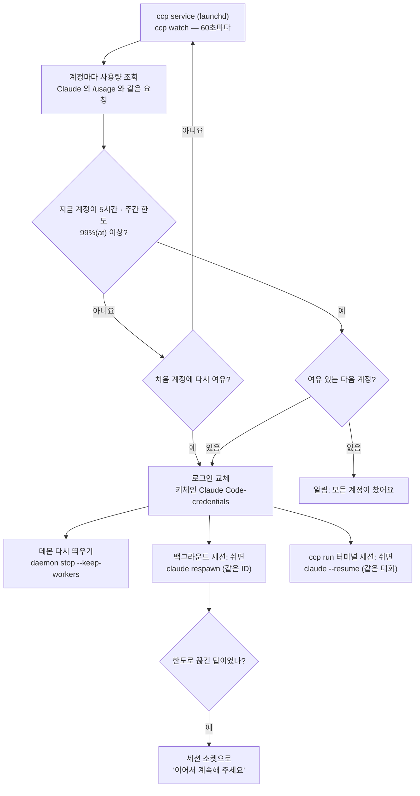

# claude-profiles (`ccp`)

컴퓨터 한 대에서 Claude Code 계정 여러 개를 로그아웃 · 로그인 없이 바꿔 써요.
계정마다 한 번만 로그인해 두면 번호가 붙고, 번호 · 명령 · 지금 있는 폴더로 골라 써요.
`ccp top` 은 계정마다 사용 한도가 얼마나 남았는지 실시간으로 보여 줘요.

[English](README.md)

```
$ ccp ls
  #   ACCOUNT                            PLAN           NAME
* 1   me@gmail.com                       max            default (~/.claude)
  2   me@company.com                     team           work
  3   me@client.io                       pro            acct-3
```

```
$ ccp top
ccp 0.7.0 · usage per account · 14:08:04 · refresh 60s (next in 57s) · r refresh · q quit

  #   ACCOUNT                        PLAN       LIMIT          USED                      LEFT  RESETS
* 1   me@gmail.com                   max 20x    5-hour         ████████████████░░  91%     9%  in 1h 12m
                                                week           █████████░░░░░░░░░  48%    52%  in 5d 21h
  2   me@company.com                 team       week           ██░░░░░░░░░░░░░░░░  12%    88%  in 3d 2h
  3   me@client.io                   pro        needs renewal: open #3 once (ccp run -p 3)
```

## 설치

설치한 뒤 컴퓨터마다 한 번 `ccp setup`(스크립트 설치는 알아서 돌려요). `claude` 를 ccp 로 띄우는 셸 줄 · 계정마다 한도가 보이는
상태 줄(선택, `ccp statusline off` 로 끄기) · Claude Code 플러그인 · 백그라운드 서비스를 한 번에 넣고, `ccp setup --undo` 로 다시 빼요.

Homebrew:

```sh
brew tap yuna-studio/claude-profiles https://github.com/yuna-studio/claude-profiles
brew install ccp
```

Claude Code 플러그인(Claude 안에서 `/ccp:usage` · `/ccp:accounts` · `/ccp:use` · `/ccp:switch` · `/ccp:auto` · `/ccp:config` · `/ccp:statusline` · `/ccp:add`, 그리고 `ccp` 명령):

```
/plugin install ccp --marketplace yuna-studio/claude-profiles
```

스크립트만(`ccp` 를 `~/.local/bin` 에 깔고 `ccp setup` 까지 돌려요. 업데이트도 같은 줄이에요):

```sh
curl -fsSL https://raw.githubusercontent.com/yuna-studio/claude-profiles/main/install.sh | sh
```

bash 스크립트 하나예요(bash 3.2 이상, macOS · Linux). 한도 화면만 `python3` 가 더 필요해요.

## 처음 쓰는 순서

1. **설치** — 위 방법 하나로 깔고 `ccp setup` 을 돌려요(스크립트 설치는 알아서 돌려요). 끝나면 **새 터미널**을 열어요(셸 줄은 새 터미널부터 먹어요).
2. **계정 더하기** — 1번(기본)은 Claude Code 에서 평소처럼 `/login` 으로 로그인한 계정이에요(`~/.claude`). 따로 등록하지
   않아요. 다른 계정은 `ccp add work` 를 치면 브라우저가 열리고, 그 계정으로 한 번 로그인하면 2번으로 등록돼요.
   그 뒤로는 놔두면 돼요 — 서비스가 돌면서 지금 계정이 기준까지 차면 여유 있는 계정 가운데 번호가 앞선 계정으로 넘겨요.
3. **확인** — `ccp ls` 로 번호 · 계정 · 플랜을, `ccp usage`(실시간은 `ccp top`)로 계정마다 남은 한도를 봐요.
4. **쓰기** — 그냥 `claude` 를 쳐요. 셸 줄 덕분에 `ccp run` 으로 떠서, 폴더 규칙이 있으면 그 계정으로, 없으면 `~/.claude` 로 열려요.
   폴더마다 계정을 정하려면 `ccp here 2 ~/work`.
5. **자동 전환 확인** — `ccp service status` 가 `running` 이면 1분마다 한도를 보고, 지금 계정이 99% 에 닿으면 다음 계정으로 넘겨요.
   더 일찍 넘기려면 `ccp config at 95`.
6. **직접 바꾸기** — 터미널에선 `ccp use 2`(또는 `ccp sw 2` 로 바꾸고 마지막 대화 이어 가기), Claude Code 안에선 아래 명령이나
   「2번 계정으로 바꿔」.
7. **되돌리기** — `ccp setup --undo` 가 셸 줄 · 상태 줄 · 서비스를 빼요(플러그인과 더한 계정은 남아요). 계정은 `ccp rm <번호>`.
   입력창 아래 한도 표시만 끄려면 `ccp statusline off`(그 뒤로 `ccp setup` 도 다시 켜지 않아요, 다시 켜기는 `ccp statusline on`).

Claude Code 안에서 쓰는 명령(플러그인):

| 명령 | 하는 일 |
|---|---|
| `/ccp:usage` | 계정마다 한도 — 쓴 양 · 남은 양 · 초기화까지 |
| `/ccp:accounts` | 계정 목록(번호 · 플랜 · 폴더 규칙) |
| `/ccp:use <번호>` | 앞으로 그 계정 로그인을 써요. 세션은 그 자리 그대로 |
| `/ccp:switch <번호>` | 이 대화와 다른 세션 모두 그 계정으로, 그 자리에서 |
| `/ccp:auto [퍼센트 \| off]` | 몇 % 에서 다음 계정으로 넘길지 · 자동 전환 끄기 |
| `/ccp:config` | 넘길 기준 · 세션 다시 띄우기 · 끊긴 답 이어 가기 · 상태 줄 표시 설정 |
| `/ccp:statusline [on \| off]` | 입력창 아래 계정별 한도 표시 켜기 · 끄기, 인자 없으면 켜져 있는지 |
| `/ccp:add [이름]` | 계정 더하기 |
| 스킬 `switch-account` | 말로 시켜요 — 「2번 계정으로 바꿔」 「다른 계정으로 넘겨」. 번호를 안 주면 `ccp usage` 로 여유 있는 계정을 골라 넘겨요 |
| 스킬 `toggle-statusline` | 말로 시켜요 — 「사용량 표시 꺼줘」 「하단 사용량 켜줘」 |

## 쓰기

```sh
ccp add                           # 2번: 브라우저가 열리면 그 계정으로 한 번 로그인
ccp add                           # 3번
ccp add -2                        # 2번 자리에 끼워 넣기: 원래 2 · 3번은 3 · 4번으로 밀림
ccp add work                      # 이름은 붙여도 되고 안 붙여도 돼요(번호는 늘 됨)

ccp use 2                         # ~/.claude 가 2번 로그인을 써요(세션은 그 자리 그대로)
ccp here 3 ~/client-x             # ~/client-x 와 그 안 폴더는 3번 계정
ccp mv 4 2                        # 순서 바꾸기
ccp which                         # 여기서 몇 번으로 열리는지, 왜 그런지
ccp usage                         # 계정마다 한도: 쓴 양 · 남은 양 · 초기화까지 (ccp top 은 실시간)
ccp run                           # 이 폴더에 맞는 계정으로 Claude Code 실행
ccp service start                 # 선택: 한도가 차면 다음 계정으로 (아래)
ccp statusline off                # 입력창 아래 계정별 한도 표시 끄기 (다시 켜기: ccp statusline on)

echo 'eval "$(ccp init zsh)"' >> ~/.zshrc   # 선택: 그냥 `claude` 를 쳐도 규칙대로 열림
```

1번은 원래 쓰던 `~/.claude`. 폴더 고르는 순서: `CCP_PROFILE`(번호나 이름) › 지금 폴더를 덮는 가장 긴 폴더 규칙 › `~/.claude`.
`ccp use` 는 폴더를 고르지 않고 `~/.claude` 가 쓰는 로그인을 바꿔요(아래).
폴더 규칙과 `ccp use` 는 번호가 아니라 계정을 기억해서, 끼워 넣거나 순서를 바꿔도 같은 계정을 가리켜요.

## 쓰는 중에 계정 바꾸기

```sh
ccp use 2             # ~/.claude 가 2번 계정 로그인을 써요. 세션은 다 그 자리에서 그대로 2번 토큰을 써요
ccp use 1             # 1번 원래 로그인으로
ccp sw 2              # ccp use 2 하고 이 폴더의 마지막 대화를 이어요(--continue)
```

Claude Code 안에서는 Claude 에게 「2번 계정으로 바꿔」라고 하거나(플러그인의 `switch-account` 스킬) `/ccp:switch 2` ·
`! ccp sw 2` 를 쳐요.

**세션은 옮기지 않아요.** Claude Code 는 `~/.claude` 의 키체인 항목(Linux 는 `.credentials.json`)에서 로그인을 읽어요.
`ccp use` 는 그 자리에 고른 계정의 로그인을 넣고 1번 원래 로그인은 따로 보관해요(키체인 항목 `ccp-stash-default`).
그래서 세션은 목록 · 폴더 · 터미널 그대로이고, 토큰이 나가는 계정만 바뀌어요. `~/.claude` 의 MCP 로그인은 그대로예요.
빌려 준 계정의 폴더에는 그동안 갱신되는 사본을 남기지 않아요(두 곳이 같은 로그인을 갱신하면 한쪽이 로그아웃돼요).
다른 계정으로 바꿀 때 가장 새 사본을 돌려받아요.

- **백그라운드 세션**(`claude --bg`, 에이전트 화면): 돌던 세션은 읽어 둔 토큰을 만료(몇 시간)까지 들고 있어서, `ccp use` 가
  세션마다 쉬는 순간 `claude respawn` 으로 그 자리에서 다시 띄워요(같은 ID · 같은 대화 · 같은 목록). 답하는 중 · 도구 실행 중 ·
  질문 중 · 걸어 둔 작업은 끊지 않아요. 데몬도 `claude daemon stop --keep-workers` 로 다시 띄워서(세션은 계속 돎) 새로 뜨는
  백그라운드 세션은 처음부터 새 로그인을 써요. 기록은 `~/.claude-profiles/respawn.log`.
- **터미널 세션**: `ccp service` 가 켜져 있을 때 `ccp run`(또는 `ccp init` 뒤의 `claude`)으로 띄운 세션은 쉬고 있을 때 같은
  터미널에서 같은 대화를 다시 열어요(`claude --resume`, `--model` 같은 옵션 그대로). ccp 를 거치지 않은 터미널은 토큰이 만료될
  때 바뀌어요(바로 바꾸려면 `/exit` 뒤 `claude --continue`).
- 폴더 규칙(`ccp here`) · `-p` · `CCP_PROFILE` 로 연 세션은 그 계정 폴더와 로그인을 그대로 써요.

`ccp setup` 이 입력창 아래에 계정마다 한도를 띄워요. `~/.claude/settings.json` 상태 줄에 `ccp prompt --usage` 를 넣어요.

```json
{ "statusLine": { "type": "command", "command": "ccp prompt --usage", "refreshInterval": 60 } }
```

```
#1                           │   ▶ #2 이 세션
5h    ··········    -        │  5h    ▊░░░░░░░░░   7%    8m
week  █████████▉  99%  4d3h  │  week  █▊░░░░░░░░  18%  5d9h
Fable ░░░░░░░░░░   0%  4d3h  │  Fable ░░░░░░░░░░   0%  5d9h
```

계정마다 한 칸, 한도마다 한 줄(5시간 · 주간 · Fable 같은 모델별 주간)이고, 1/8 칸까지 채우는 막대 · 연한 초록 · 주황 · 빨강 % · 오른쪽에 리셋까지 남은 시간이에요. `▶` 가 이 세션의 계정이에요(`~/.claude` 세션이면 `~/.claude` 가 지금 쓰는 로그인의 계정).  숫자는 `ccp service` 가 마지막으로 읽은 사용량이에요(안 쓰는 계정은 5분마다 읽어서 그만큼 오래됐을 수 있어요. 2분이 넘으면 머리글에 얼마나 오래됐는지, 액세스 토큰이 만료됐으면 `갱신 필요` 가 보여요)(서비스가 꺼져 있으면 계정 번호만). 그냥 `ccp prompt` 는 `#2 work` 만 찍어요.

선택 기능이고 기본은 켜짐이에요.

```sh
ccp statusline                 # 켜져 있는지 · 몇 초마다 다시 그리는지
ccp statusline off             # 빼기. 그 뒤로 ccp setup 도 다시 넣지 않아요 (ccp config statusline off 와 같아요)
ccp statusline on              # 다시 넣기
```

- **ccp 것만 바꿔요.** 상태 줄 명령이 ccp 것(`ccp prompt …`)일 때만 넣고 빼요. 따로 둔 상태 줄은 켜든 끄든 그대로 두고,
  원하면 `$(ccp prompt --usage)` 를 직접 넣어요.
- **언제 보이나.** Claude Code 가 `settings.json` 을 다시 읽을 때부터예요. Claude Code 는 설정 파일을 지켜보다 바뀌면 다시 읽고,
  상태 줄 명령이 바뀌면 바로 새 명령을 돌려요([설정](https://code.claude.com/docs/en/settings#when-edits-take-effect) ·
  [상태 줄](https://code.claude.com/docs/en/statusline#when-the-status-line-updates) 문서). 그래서 돌던 세션도 저절로 따라가고,
  새 세션은 늘 처음부터 반영돼요. Claude Code 문서 기준이고(2.1.328 에서 확인) 돌던 세션에서 직접 보지는 않았어요. 자기 프로필 폴더로 연
  세션은 `settings.json` 을 링크로 읽으니 새 세션부터라고 보세요.
- **1분마다 다시 그려요.** Claude Code 는 자기 세션에 일이 있을 때(새 답 · `/compact` · 모드 변경)만 상태 줄 명령을 다시 돌려서, 쉬는 세션은 숫자가 그대로 멈춰 있어요.
  그래서 ccp 는 `refreshInterval`(초)을 `ccp service` 확인 주기(60, `--every` 를 줬으면 그 값)로 넣어요. 0.6.0 전에 넣은 ccp 상태
  줄은 `ccp statusline on` 이나 `ccp setup` 이 채워 넣고, `ccp service start --every N` 은 그 값에 맞춰요.
- **조회하지 않아요.** `ccp prompt --usage` 는 `~/.claude-profiles`(계정 목록과 `ccp service` 가 마지막으로 본 `seen`)만 읽어요.
  사용량 주소도 Claude Code 도 부르지 않아서, 세션마다 1분마다 돌아도 사용량 조회 한도나 토큰을 쓰지 않아요.

## 한도가 차면 다음 계정으로

켜야 돌아요. 내 계정들에만 쓰세요.

```sh
ccp service start              # macOS: 백그라운드 서비스(launchd), 로그인하면 다시 켜져요
ccp service start --at 95      # 더 일찍 넘기기 (기본은 99%), Claude Code 안에선 /ccp:auto 95
ccp service status             # 도는지 · 지금 계정 · 찬 계정 · 마지막 기록
ccp service stop
```

1분마다 계정별 사용량을 봐요(`ccp top` 과 같은 요청). 지금 계정(`~/.claude` 가 쓰는 로그인의 계정)이 5시간이나 주간 한도
99%(`--at`)에 닿으면, `ccp use` 처럼 여유 있는 다음 계정의 로그인을 `~/.claude` 에 넣고 알림을 띄워요. 처음 계정에 여유가 다시
생기면(보관 중이면 그 한도의 리셋 시각이 지나면) 그 로그인으로 돌아가요. 세션은 위처럼 그 자리에 그대로 있고, 일하는 중인 세션
(답하는 중 · 도구 실행 중 · 질문 중)은 끊지 않아요.

**다음 확인을 기다리지 않아요.** 1분마다 확인하면 늦을 수 있고, 사용량 주소가 가끔 「너무 자주 물었다」(asked too often)고 답해요
(같은 계정을 가진 컴퓨터마다 따로 묻기 때문이에요). 그래서 찬 계정이 그대로 남지 않게 네 가지를 해요. 마지막은 두 계정을 왔다 갔다 하지
않게 해요.

- **쓰는 계정은 바로 다시 물어요.** 「너무 자주 물었다」면 「안 찼다」로 보지 않고 3초 뒤 한 번 더 물어요. 다른 계정이 뭐라 답하든 쓰는 계정은
  매 회차 물어요. 주소가 어느 계정 때문에 `ccp watch` 를 덜 묻게 만들었는지 로그에 남겨요.
- **지금 못 물어본 다음 계정은 마지막으로 잘 본 숫자(`seen`)로 판단해요.** 그때 한도에 닿아 있었고 리셋 시각도 안 지났을 때만 여유 없음으로
  봐요. 숫자가 아예 없으면 시도해 봐요. 「모든 계정이 찼다」는 시도해 볼 계정이 하나도 없을 때만이에요.
- **한도에 걸린 세션이 바로 확인을 시켜요.** `ccp service start` 가 Claude Code 의 `StopFailure` 훅(`rate_limit`, API 오류로 턴이
  끝날 때 도는 훅)을 `~/.claude/settings.json` 에 넣어요. 훅은 `ccp limit-hit` 을 부르고, 이 명령은 바로 돌아오고 확인은 백그라운드에서 해요.
  `~/.claude` 의 로그인을 쓰는 세션만 해당해요(폴더 규칙 · `-p` · 자기 설정 폴더 세션은 자기 계정을 지켜요). 같은 1분 안에 한도에 걸린
  다른 세션들은 그 확인을 기다려요. 지금 계정의 숫자가 여유 있다고 말하면 숫자를 믿고 아무것도 옮기지 않아요(그 세션이 ccp 가 방금 떠난
  계정이나 Claude Code 데몬이 뜰 때 읽은 옛 토큰을 아직 쥐고 있을 수 있어요). 지금 못 물어보면 마지막으로 잘 본 숫자로 판단해요. 95%
  (`--at` 이 더 낮으면 그 값) 아래였다면 아무것도 옮기지 않고, 더 높았거나 숫자가 없으면 찬 것으로 봐요. 훅은 그 턴을 Claude Code 가
  어떻게 다루는지는 바꾸지 못하고, 아래 다시 띄우기와 `continue` 가 하던 일을 이어 가요. ccp 것(`ccp limit-hit` 명령)만 넣고 빼고,
  내 훅은 그대로 둬요.
- **찬 계정에서 옮겨 온 뒤에는 그 한도가 리셋되기 전까지 그 계정을 다시 빌려주지 않아요**(`benched` 에 적어 둬요). 지금 못 물어볼 때
  이야기이고, 새로 읽은 숫자가 한도 아래면 돌아가요. 로그인이 만료된 계정도 마지막 숫자가 차 있었으면 빌려주지 않아요(Claude Code 가
  갱신해도 같은 한도에 바로 걸려요).

설정은 모두 기본으로 켜져 있어요(Claude Code 안에선 `/ccp:config`).

```sh
ccp config                     # 보기
ccp config at 95               # 99% 대신 95%에서 넘기기
ccp config respawn off         # 넘긴 뒤 돌던 세션을 다시 띄우지 않기(들고 있는 토큰이 끝날 때까지 그대로)
ccp config continue off        # 한도로 끊긴 세션이 저절로 이어가지 않고 입력을 기다리기
ccp config statusline off      # 입력창 아래 한도 표시 끄기, ccp setup 도 다시 넣지 않아요 (ccp statusline off 와 같아요)
ccp config hook off            # 훅 없이 1분마다 확인으로만 넘기기 (ccp service start 도 넣지 않아요)
```

`continue` 가 켜져 있으면, 답하는 중에 한도로 끊긴 세션을 새 계정으로 그 자리에서 다시 띄운 뒤, 세션끼리 메시지를 주고받는
로컬 소켓으로 「이어서 계속해 주세요」를 보내요. 세션은 그걸 팀원의 요청으로 받아 하던 일을 이어가요.

Linux 에서는 `ccp watch` 를 systemd `--user` 나 tmux 로 띄워 두세요. 기록은 `~/.claude-profiles/watch.log` 에 남아요.

## 한도 감지 · 세션 교체는 이렇게 돌아가요

한 줄로: **세션을 옮기지도, 새로 만들지도 않아요.** `~/.claude` 가 읽는 로그인만 다음 계정 것으로 바꾸고, 돌던 세션은 쉬는 순간
**같은 세션 ID 로 다시 띄워** 로컬 대화 기록을 다시 읽게 해요.



### 먼저 — Claude Code 세션은 이렇게 생겼어요

**Claude 서버는 대화를 기억하지 않아요.** 요청할 때마다 Claude Code 가 지금까지의 대화를 통째로 보내요. 대화는 내 PC 파일에
있고, 계정은 실행 중인 프로세스가 들고 있는 토큰일 뿐이에요. 그래서 쉬는 순간 프로세스만 새 토큰으로 다시 띄우면 같은 세션 ·
같은 대화로 계정만 바뀌어요.

| 층 | 무엇인가 | 어디에 있나 |
|---|---|---|
| 프로그램 | `claude` 실행 파일 | 설치 위치 |
| 프로세스 | 실행 중인 `claude` 하나(pid). **시작할 때 키체인에서 토큰을 읽어 메모리에 들고 있어요**(만료까지 몇 시간). MCP 연결도 메모리에 있어요 | 메모리. 실행 정보는 `~/.claude/sessions/<pid>.json`(쉬는 중인지, sessionId, 메시지 소켓) |
| 세션 | 대화 하나. **프로세스가 아니에요** — 같은 세션이 여러 번, 다른 프로세스로 뜰 수 있어요 | sessionId(UUID). 백그라운드 세션은 목록용 짧은 id 와 다시 띄울 옵션을 따로 가져요(`~/.claude/jobs/<id>/state.json`) |
| 컨텍스트 | 대화 기록 | **로컬 파일** `~/.claude/projects/<프로젝트>/<sessionId>.jsonl` |

세션은 두 종류예요(`claude agents --json` 의 `kind`).

| | 대화형(interactive) | 백그라운드(background) |
|---|---|---|
| 띄우는 법 | 터미널에서 그냥 `claude` | `claude --bg`, 에이전트 화면(`claude agents`)에서 맡기기, 대화형 세션을 ← 로 넘기기 |
| 관리 | 그 터미널. 창을 닫으면 끝 | Claude Code **데몬**. 터미널과 떨어져 돌고, 에이전트 화면에서 붙었다 뗐다 해요 |

**데몬**은 ccp 가 아니라 Claude Code 자체의 감독 프로세스(`claude daemon`)예요. 필요할 때 `claude` 가 띄우고, 붙은
클라이언트와 백그라운드 세션이 없으면 스스로 꺼져요. 띄우고 다시 띄우는 대상은 **백그라운드 세션뿐**이라(`claude respawn` 도
백그라운드 세션만 돼요), 터미널 세션은 ccp 가 직접 넘겨요.

| 세션 | 관리 주체 | 넘기는 방법 | 언제 |
|---|---|---|---|
| 백그라운드 | Claude Code 데몬 | ccp 가 `claude respawn <id>` 로 데몬에게 시켜요(아래 4) | 쉬는 순간 바로 |
| 터미널 — ccp 로 띄운 것 | ccp(`ccp run` 이 `claude` 위에 남아 감시) | `claude` 를 끝내고 같은 창에서 `claude --resume <sessionId>`(아래 5) | 쉬는 순간 바로 |
| 터미널 — ccp 없이 띄운 것 | 없음 | 다시 띄우지 않아요. 바로 바꾸려면 `/exit` 뒤 `claude --continue` | 들고 있던 토큰이 만료될 때 |
| 데스크톱 앱 · IDE 확장 | 없음 | 다시 띄우지 않아요 | 토큰이 만료될 때 |
| 폴더 규칙(`ccp here`) · `-p` 로 연 세션 | - | 넘기지 않아요(일부러 그 계정에 묶어 둔 세션) | - |

터미널 세션이 「ccp 로 띄운 것」이 되는 조건: ① 설치 뒤 **새로 연 터미널**에서 그냥 `claude`(셸 줄이 `claude` 를 `ccp run` 으로
바꿔요) ② 서비스가 켜져 있음 ③ 기본 계정(`~/.claude`)으로 연 대화형 세션.

### 1. 감지 — `ccp watch`

- `ccp service start`(`ccp setup` 이 켜요)는 macOS launchd 에 ccp 서비스를 올려요(`~/Library/LaunchAgents/` 의 ccp plist).
  로그인하면 켜지고, 죽으면 다시 켜져요. 하는 일은 `ccp watch` 하나예요. 도는지는 `ccp service status` 로 봐요.
- 60초(`--every`, 30~300초, 컴퓨터끼리 같은 때에 묻지 않게 조금씩 달라요)마다 쓰는 계정의 로그인 토큰으로 Anthropic 사용량 주소를 불러
  5시간 · 주간 · 모델별 주간 한도를 읽어요. 다른 계정은 5분마다, 쓰는 계정이 넘길 참이면 바로 물어요. Claude 안의 `/usage` 와 같은
  요청이고, 토큰은 다른 곳에 보내지 않아요.
- 본 것은 `~/.claude-profiles/` 에 남겨요. `seen` 은 마지막 사용량과 읽은 때(상태 줄이 이걸 읽어요), `full` 은 한도에 닿은 계정이에요.
  사용량 주소가 어떤 계정을 너무 자주 묻는다고 하면 그 계정만 쉬어요. 2분, 4분, 8분, 최대 10분(`asked`)이고, 다른 계정과 쓰는 계정은
  제 속도로 가요.
- 「지금 계정」은 `~/.claude` 가 지금 쓰는 로그인의 계정이에요(`slot`, 없으면 1번).
- Linux 에는 `ccp service` 가 없어요. `ccp watch` 를 systemd `--user` 나 tmux 로 직접 띄워요. Windows 는 지원하지 않아요(bash 스크립트).

### 2. 로그인 교체 — 세션은 그 자리에

- Claude Code 는 로그인을 키체인 항목 `Claude Code-credentials`(Linux 는 `~/.claude/.credentials.json`)에서 읽어요.
  지금 계정이 기준(`at`, 기본 99%)에 닿으면 ccp 는 여유 있는 계정 가운데 번호가 앞선 계정의 Claude 로그인(`claudeAiOauth`)을 이 항목에 넣어요.
  같은 항목에 든 MCP 로그인은 건드리지 않아요.
- 1번 원래 로그인은 키체인 항목 `ccp-stash-default` 에 따로 보관해요.
- 빌려 준 계정의 자기 폴더 사본은 갱신 토큰을 비워 둬요. 같은 로그인을 두 곳이 갱신하면 한쪽이 로그아웃되기 때문이에요.
  다른 계정으로 바꿀 때 `~/.claude` 에서 갱신된 가장 새 사본을 원래 자리로 돌려줘요.
- 토큰은 명령줄 · 화면 · 로그에 남지 않아요(키체인에는 `security -i` 표준 입력으로 써요).

### 3. 왜 세션을 다시 띄우나

돌던 Claude Code 세션은 시작할 때 읽은 토큰을 만료(몇 시간)까지 들고 있어요. 키체인만 바꾸면 이미 돌던 세션은 그동안 찬 계정을
계속 써요. 그래서 세션마다 **쉬는 순간에** 다시 띄워 새 로그인을 읽게 해요. 대화는 로컬 기록 파일
(`~/.claude/projects/<프로젝트>/<sessionId>.jsonl`)에 있으니 다시 띄워도 그대로 이어져요.

### 4. 백그라운드 세션 (`claude --bg`, 에이전트 화면)

1. **데몬** — `claude daemon stop --any --keep-workers` 로 데몬만 내리고(돌던 세션은 그대로 돌아요) `claude agents` 로 다시
   올려요. 그 뒤 새로 뜨는 백그라운드 세션은 처음부터 새 로그인을 써요.
2. **세션마다 대기자** — `claude agents --json --all` 로 `~/.claude` 에서 도는 백그라운드 세션을 찾아, 세션마다 대기자
   (`ccp _respawn`)를 따로 띄워요. ccp 가 끝나도 남도록 분리해서 띄우고, 한 세션에 대기자는 하나만 둬요(`respawning/<id>` 잠금).
3. **쉴 때까지 기다리기** — `~/.claude/sessions/<pid>.json` 의 상태가 idle 이고, `~/.claude/jobs/<id>/state.json` 에 걸어 둔
   작업(빌드 · 셸 같은 것)이 없을 때까지 기다려요. 처음 1분은 1초, 그 뒤엔 5초마다 보고, 최대 하루까지 기다려요.
   답하는 중 · 도구 실행 중 · 질문 중 · 걸어 둔 작업은 끊지 않아요.
4. **이름 지키기** — `claude respawn` 은 세션을 처음 띄울 때의 옵션으로 다시 띄워서, 나중에 붙인 이름이 빠질 수 있어요. 그래서
   다시 띄우기 전에 그 세션의 이름을 `jobs/<id>/state.json` 의 다시 띄울 옵션(`respawnFlags`)에 `--name <이름>` 으로 넣어요.
   이름을 바꾸는 게 아니라 **그대로 지키는** 거예요.
5. **다시 띄우기** — `claude respawn <id>`. 프로세스는 새로 떠요(pid 가 바뀌어요). 세션 ID · 목록 자리 · 이름 · 대화는 같아요.
6. 기록은 `~/.claude-profiles/respawn.log` 에 남아요.

### 5. 터미널 세션 (`ccp run`, 또는 `ccp init` 뒤의 `claude`)

1. 서비스가 켜져 있으면 `ccp run` 은 `claude` 를 띄운 뒤 그 옆에 붙어 있어요. **ccp 프로세스와 터미널은 그대로**이고, 그 안의
   `claude` 프로세스만 바뀌어요.
2. 감시자가 1초마다 `~/.claude` 의 로그인이 바뀌었는지 봐요. 바뀌었고 세션이 idle 이면 `claude` 에 끝내라는 신호(TERM, 10초 안에
   안 끝나면 KILL)를 보내요.
3. 같은 터미널에서 `claude --resume <sessionId>` 로 같은 대화를 다시 열어요. 처음 줬던 `--model` · `--permission-mode` ·
   `--add-dir` · `--effort` 같은 옵션은 그대로 붙이고, 첫 프롬프트와 `--continue` 는 빼요.
4. ccp 를 거치지 않고 띄운 터미널 세션은 토큰이 만료될 때 바뀌어요. 바로 바꾸려면 `/exit` 뒤 `claude --continue`.

### 6. 한도로 끊긴 답 이어 가기 (`continue`)

- 백그라운드 세션을 다시 띄우기 전에, 그 대화 기록의 마지막 답이 사용 한도 오류(`rate_limit`)인지 봐요.
- 그렇다면 다시 뜬 세션이 idle 이 될 때(최대 2분) 그 세션의 메시지 소켓(세션끼리 메시지를 주고받는 로컬 소켓,
  `sessions/<pid>.json` 의 `messagingSocketPath`)에 그 세션 키로 인증하고 「사용 한도에 걸려 끊겼던 작업을 이어서 계속해 주세요」를
  보내요. 세션은 팀원의 요청처럼 받아 하던 일을 이어 가요.
- 터미널 세션은 이 단계가 없어요. 다시 열린 뒤 「계속해」라고 치면 돼요.

### 7. 원래 계정으로 돌아가기 · 모두 찼을 때

- 처음 넘길 때 원래 계정과 그 한도가 풀리는 시각을 `moved` 에 적어요. 원래 계정에 다시 여유가 생기면(보관 중이라 사용량을 못 읽으면
  그 리셋 시각이 지나면) 그 로그인으로 돌아가고, 위 2~6 이 똑같이 돌아요.
- 넘길 계정이 없으면 「모든 계정이 찼어요」 알림을 한 번 띄우고(`stuck`) 기다려요.
- 직접 `ccp use` · `ccp sw` 로 고르면 자동으로 되돌리지 않아요.
- 넘길 때마다 macOS 알림(Linux 는 `notify-send`)을 띄우고 `watch.log` 에 남겨요.

### 넘어갈 때 바뀌는 것 · 그대로인 것

| | 백그라운드 (`claude respawn`) | 터미널 (`ccp run` → `--resume`) |
|---|---|---|
| 프로세스(pid) | 새로 떠요 | `claude` 만 새로 떠요. ccp 프로세스와 터미널 창은 그대로 |
| 토큰(계정) | 새 계정 | 새 계정 |
| sessionId · 대화 기록 | 같아요 — 같은 파일을 다시 읽어요 | 같아요 — `--resume` 은 기본으로 같은 ID 를 이어 써요(`--fork-session` 을 줘야 새 ID) |
| 목록 자리 · 짧은 id · 이름 | 같아요(이름은 `--name` 으로 지켜요) | 처음 띄울 때 옵션(`--model` 등)을 그대로 다시 붙여요 |
| 메모리 상태(MCP 연결 등) | 새로 연결 | 새로 연결 |
| 데몬 다시 띄우기 | 해요(이후 새로 뜨는 백그라운드 세션용) | 상관없어요 |
| 한도로 끊긴 답 이어 가기 | 해요(「이어서 계속해 주세요」) | 안 해요(직접 「계속해」) |

### 새로 띄우기 · resume · respawn 차이

- **그냥 `claude`** — 새 세션이에요. 새 sessionId, 빈 대화.
- **`claude --resume <sessionId>`** — 같은 대화를 새 프로세스로 이어 써요. 백그라운드 목록 자리나 처음 띄울 때 옵션은 직접
  챙겨야 해요. ccp 는 터미널 세션에 이걸 써요.
- **`claude respawn <id>`** — 데몬이 그 백그라운드 세션을 같은 자리(같은 짧은 id · 대화 · 처음 띄울 때 옵션)로 다시 띄워요.
  공식 용도는 「새 Claude 실행 파일로 갈아타기」이고, ccp 는 이걸 「새 로그인 읽히기」로 써요.
- **`claude agents --json --all`** — 지금 세션 목록(대화형 · 백그라운드)을 JSON 으로 뽑는 스크립트용 명령이에요. `--all` 은
  끝난 백그라운드 세션까지 보여요. ccp 는 여기서 살아 있는 백그라운드 세션만 골라 대기자를 붙이고, 이 명령이 데몬이 꺼져 있으면
  데몬을 띄우는 성질로 데몬을 다시 올려요.

### 사용자에게 보이는 것

- **보여요**: 넘어갈 때마다 macOS 알림 한 번. 상태 줄의 지금 계정 표시가 바뀌어요. 터미널 세션은 화면이 잠깐 닫혔다 같은 창에서
  다시 열려요(`ccp: now on #2 …'s login; this conversation goes on`). 백그라운드 세션은 에이전트 화면의 같은 자리 · 같은
  이름으로 다시 떠요.
- **그대로예요**: 대화 내용 · 세션 이름 · 목록 자리 · 작업 폴더. 답하는 중 · 도구 실행 중 · 질문 중에는 끊지 않아요.
- **알아 둘 것(확인 못 함)**: 터미널 세션은 쉬는 순간 넘어가므로 입력창에 쓰다 만 글이 있었다면 사라질 수 있어요. 넘어간 직후
  첫 응답은 프롬프트 캐시가 계정(조직)별이라 조금 느리고 토큰을 조금 더 쓸 수 있어요.

### 자원 사용량 · 사용량 조회 한도

맥북에서 잰 값(2026-11-19)이에요.

| 항목 | 값 |
|---|---|
| 서비스 본체(bash) | 24분 동안 CPU 0.15초, 메모리 3MB. 평소에는 `sleep 60` 으로 쉬어요 |
| 한 번 확인 | 약 0.65초 동안 python 이 잠깐 뜨고 CPU 약 0.1초 · 메모리 최대 22MB 쓴 뒤 끝나요 |
| 1시간 평균 | CPU 약 6초 — 코어 하나의 0.2% 이하 |

- 요청은 계정마다 `GET https://api.anthropic.com/api/oauth/usage` 한 번이에요. Claude 안의 `/usage` 와 같은 요청이고, 모델
  호출이 아니라 사용 한도(토큰)를 쓰지 않는 것으로 봐요.
- 이 주소의 호출 한도는 공개 문서에 숫자가 없고, 429 응답의 `Retry-After: 0` 도 아무것도 알려 주지 않아요. 429(너무 자주 물음)를
  받은 계정은 그때마다 두 배씩(최대 10분) 쉬고, 상태 줄은 그 계정의 마지막 숫자를 얼마나 오래됐는지와 함께 보여 줘요.
- 조회는 PC 마다 따로 나가요. 한 계정을 여러 사람이 각자 PC 에 등록하면 모두가 물어요. 쓰는 계정은 1분에 한 번, 나머지는 5분에
  한 번이에요. 사람이 많으면 `ccp service start --every 120` 처럼 간격을 늘려요.
- 액세스 토큰은 약 8시간이고 ccp 는 갱신하지 않아요. 토큰이 만료된 계정은 물어볼 수 없어서 마지막 숫자가 `갱신 필요` 와 함께 남아요.
  로그아웃된 게 아니에요. 갱신 토큰은 그대로라서 Claude Code 가 그 계정으로 한 번 돌면(`ccp run -p N`, 또는 `ccp use N` 으로 잠깐)
  바로 갱신해요. `claude auth status` 만으로는 갱신되지 않아요(2026-11-20 에 시험).

### 오해하기 쉬운 것

| 생각하기 쉬운 것 | 실제 |
|---|---|
| 프로세스는 그대로 두고 로그인만 바꾼다 | 돌던 `claude` 프로세스는 이미 읽은 토큰을 들고 있어서 다시 띄워요. 그대로인 것은 세션 ID · 대화 · 이름 · 목록 자리 · 터미널(ccp 프로세스)이에요 |
| 새 세션을 만들고 거기에 대화를 붙인다 | 새 세션이 아니라 같은 세션을 다시 띄워요(백그라운드는 `claude respawn <id>`, 터미널은 `--resume <sessionId>`). 대화는 로컬 기록 파일을 다시 읽어요 |
| 세션 이름을 바꾼다 | 바꾸지 않고 지켜요. 다시 띄울 옵션에 `--name` 을 넣어 같은 이름으로 떠요 |
| 프로필 폴더를 옮겨 다닌다 | 자동 전환은 폴더를 바꾸지 않아요. `~/.claude` 의 로그인만 바꿔요. 폴더 규칙(`ccp here`) · `-p` 로 연 세션은 그 계정 그대로예요 |

### 남는 파일

| 위치 | 내용 |
|---|---|
| `~/Library/LaunchAgents/` 의 ccp plist | 서비스 정의(`ccp watch`) |
| `~/.claude-profiles/slot` | 지금 `~/.claude` 에 든 로그인의 계정 |
| `~/.claude-profiles/seen` · `full` | 마지막으로 본 사용량 · 한도에 닿은 계정 |
| `~/.claude-profiles/moved` · `stuck` · `asked` | 돌아갈 계정 · 모두 찬 상태 · 안 쓰는 계정을 다음에 물을 때와 그 계정의 쉬는 시간 |
| `~/.claude-profiles/config` · `auto` | `ccp config` 값 · 서비스 설정 |
| `~/.claude-profiles/respawning/<id>` | 세션별 대기자 잠금 |
| `~/.claude-profiles/watch.log` · `respawn.log` | 감지 · 교체 기록 · 세션 다시 띄우기 기록 |

## 어떻게 되나

Claude Code 는 설정 폴더(`~/.claude`, 또는 `CLAUDE_CONFIG_DIR`)를 하나 써요. `CLAUDE_CONFIG_DIR` 를 주면 로그인도 따로
저장해요(macOS 는 폴더마다 다른 키체인 항목, Linux 는 그 폴더 안 `.credentials.json`). 그래서 프로필은
`~/.claude-profiles/<이름>`(이름 없으면 `acct-N`) 폴더 하나이고, `ccp` 는 그 폴더를 `CLAUDE_CONFIG_DIR` 로 주고 `claude` 를 띄워요.
로그인이 폴더 경로에 묶여 있어서 폴더 이름은 절대 바꾸지 않아요. 번호는 따로 둔 순서표에서 매기고, 지운 폴더 이름은 다시 쓰지 않아요.

설정 · CLAUDE.md · 에이전트 · 명령 · 스킬 · 플러그인 · 대화 기록(projects)은 `~/.claude` 것을 함께 써서, 어느 계정으로 열어도
같은 환경이고 `claude --resume` 도 같은 대화를 보여요. 계정 · 로그인만 프로필마다 따로예요. `--isolated` 는 아무것도 나누지 않아요.
로그인 · 로그아웃은 `claude auth login` / `logout` 이 해요. `ccp usage` · `ccp top` 은 계정마다 Claude Code 가 둔 로그인 토큰(키체인 · `.credentials.json`)을 읽어
Anthropic 사용량 주소(Claude 안의 `/usage` 와 같은 요청)에만 보내요. 토큰은 화면 · 파일 · 명령줄에 남기지 않고, 만료되면 그 계정으로 한 번 열면 Claude Code 가 갱신해요.

## 비슷한 도구와 견줘 보면

[claude-rotate](https://github.com/doxaras/claude-rotate) 는 같은 문제(계정 한도가 차면 다른 계정으로 넘기기)를 한 층 아래에서 풀어요.
요청 경로에 끼는 서버 프록시이고, `ccp` 는 각 컴퓨터의 로그인과 세션을 바꿔요. 2026-11-19 에 두 저장소의 README · 코드로 견줬고
(claude-rotate 는 `ebca191`), 둘 다 실제 한도에 닿아 돌려 보지는 않았어요.

| | claude-rotate | ccp |
|---|---|---|
| 형태 | 항상 켜 둘 서버(프록시, Python). 기기는 서버 주소와 기기 키만 설정해요 | 컴퓨터마다 설치하는 명령(bash). 서버 없이 한 줄로 설치해요 |
| 계정 바꾸는 방식 | 요청마다 프록시가 다음 계정의 토큰을 바꿔 끼워요. 실행 중인 세션을 다시 띄울 필요 없어요 | Claude Code 가 읽는 로그인(키체인)을 바꾸고, 쉬는 세션을 같은 세션 ID 로 다시 띄워요 |
| 로그인 · 토큰 | 계정마다 1년짜리 토큰(`claude setup-token`)을 서버에 모아 둬요. 서버가 뚫리면 모든 계정이 위험해요 | 컴퓨터마다 키체인에 평소 로그인으로 둬요. 토큰이 컴퓨터 밖으로 나가지 않아요 |
| 넘길 때를 아는 법 | 요청마다 응답 헤더(`anthropic-ratelimit-unified-*`)의 정확한 사용률과 한도 오류(429)를 봐요 | 1분마다 사용량을 조회(`ccp watch`)하고 기본 99% 에서 넘겨요. 두 번 확인 사이의 변화는 다음 확인 때 반영돼요 |
| 다음 계정 고르기 | 주간 한도가 먼저 풀리는 계정(`consume-first`)이나 가장 덜 쓴 계정. 쿨다운으로 왔다 갔다를 막아요 | 번호가 앞선 여유 있는 계정. 처음 계정에 여유가 생기면 돌아가요. 폴더마다 계정을 고정할 수도 있어요 |
| 여러 사람 · 기기 | 서버 한 대를 여러 기기가 같이 써요. 기기별 사용량 · 비용 환산 화면이 있어요. 한 번에 한 계정만 켜져 있어 모든 기기가 같은 계정을 써요 | 컴퓨터마다 따로 돌고 기기별 집계 화면은 없어요. 계정별 남은 한도는 상태 줄에 보여요(모델별 주간 한도 포함) |
| 필요한 것 | 서버 운영, 사설망(평문 HTTP 라 Tailscale 같은 망이 필요), 설정을 바꾸면 재시작 | Claude Code 와 python3 만. macOS · Linux |
| 잘 맞는 곳 | 기기 여러 대 · CI · 서버가 계정 한 묶음을 같이 쓸 때 | 한 사람이 자기 컴퓨터에서 계정 여러 개를 돌려 쓸 때 |
| 아쉬운 점 | 서버를 운영해야 해요. 모든 토큰이 한곳에 모여요. 모델별 한도는 따로 보지 않아요 | 최대 1분 늦게 반응해요. 고르는 기준이 단순(번호순)해요. 컴퓨터마다 사용량을 따로 조회해요 |

어느 쪽이든 계정이 바뀐 뒤 첫 답은 새 계정에서 프롬프트 캐시를 다시 쌓느라 조금 느리고 토큰을 더 쓸 수 있어요.

## 알아 둘 것

- 계정 공유용이 아니에요. 한도가 차면 넘기는 기능은 직접 켜야 돌아요. 개인 · 회사 · 고객사처럼 내 계정을,
  각 계정의 Anthropic 약관대로 쓰세요.
- 데스크톱 앱 · IDE 확장은 계속 `~/.claude` 를 써요. `ccp` 는 터미널에서 띄우는 것만 바꿔요.

MIT
