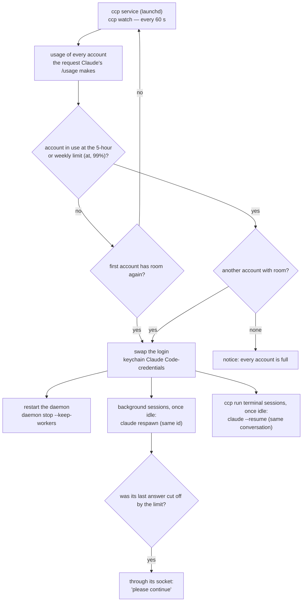

# claude-profiles (`ccp`)

Use several Claude Code accounts on one computer without logging out and in again.
Sign in once per account; accounts are numbered, you pick one by number, by command, or by the folder you are in,
and `ccp top` shows every account's usage limits live.

[한국어](README.ko.md)

```
$ ccp ls
  #   ACCOUNT                            PLAN           NAME
* 1   me@gmail.com                       max            default (~/.claude)
  2   me@company.com                     team           work
  3   me@client.io                       pro            acct-3

folder rules:
  /Users/me/work → #2 work
  /Users/me/client-x → #3
```

```
$ ccp top
ccp 0.7.0 · usage per account · 14:08:04 · refresh 60s (next in 57s) · r refresh · q quit

  #   ACCOUNT                        PLAN       LIMIT          USED                      LEFT  RESETS
* 1   me@gmail.com                   max 20x    5-hour         ████████████████░░  91%     9%  in 1h 12m
                                                week           █████████░░░░░░░░░  48%    52%  in 5d 21h
  2   me@company.com                 team       week           ██░░░░░░░░░░░░░░░░  12%    88%  in 3d 2h
  3   me@client.io                   pro        needs renewal: open #3 once (ccp run -p 3)
```

## Install

One command per computer after installing: `ccp setup` (the script installer runs it for you). It adds the shell
line that sends `claude` through `ccp`, the status line with every account's limits (optional: `ccp statusline off`),
the Claude Code plugin and the background service; `ccp setup --undo` takes them out again.

Homebrew:

```sh
brew tap yuna-studio/claude-profiles https://github.com/yuna-studio/claude-profiles
brew install ccp
```

As a Claude Code plugin (adds `/ccp:usage`, `/ccp:accounts`, `/ccp:use`, `/ccp:switch`, `/ccp:auto`, `/ccp:config`, `/ccp:statusline`, `/ccp:add`, and `ccp` inside Claude Code):

```
/plugin install ccp --marketplace yuna-studio/claude-profiles
```

Or the script alone (it puts `ccp` in `~/.local/bin` and runs `ccp setup`; the same line updates it):

```sh
curl -fsSL https://raw.githubusercontent.com/yuna-studio/claude-profiles/main/install.sh | sh
```

One bash script (bash 3.2+, macOS and Linux); the usage view also needs `python3`. Nothing else besides Claude Code.

## First steps

1. **Install** as above, then `ccp setup` (the script installer runs it for you). Then open a **new terminal** (the shell line applies there).
2. **Add accounts.** #1, the default, is the account you signed in to Claude Code with as usual (`/login`, in `~/.claude`);
   there is nothing to register. For another one, `ccp add work` opens the browser: sign in with that account once and it
   becomes #2. Then leave it alone: the service watches, and when the account in use reaches the limit it moves on to the
   first account, by number, that has room.
3. **Check** with `ccp ls` (number, account, plan) and `ccp usage` (`ccp top` for a live view) for what each account has left.
4. **Work** by typing plain `claude`. The shell line starts it through `ccp run`: a folder rule picks its account, otherwise
   it opens on `~/.claude`. To tie a folder to an account: `ccp here 2 ~/work`.
5. **Automatic switching:** `ccp service status` says `running` when it checks every minute. To move on earlier:
   `ccp config at 95`.
6. **Switch by hand:** `ccp use 2` in a terminal (or `ccp sw 2` to switch and continue the last conversation here); inside
   Claude Code, the commands below or "switch to account 2".
7. **Undo:** `ccp setup --undo` takes out the shell line, the status line and the service (the plugin and your accounts stay).
   Remove an account with `ccp rm <number>`. To hide only the limits under the prompt: `ccp statusline off` (`ccp setup`
   leaves them out from then on; `ccp statusline on` brings them back).

Inside Claude Code (the plugin):

| Command | What it does |
|---|---|
| `/ccp:usage` | Every account's limits: used, left, when they reset |
| `/ccp:accounts` | The accounts by number, with plan and folder rules |
| `/ccp:use <number>` | Use that account's login from now on; every session stays where it is |
| `/ccp:switch <number>` | This conversation and every other one on that account, in place |
| `/ccp:auto [percent \| off]` | At what percent to move on to the next account, or turn it off |
| `/ccp:config` | When to switch, whether sessions restart in place, whether a cut-off one goes on, whether the status line shows |
| `/ccp:statusline [on \| off]` | Every account's limits under the prompt, on or off; no argument: whether it is on |
| `/ccp:add [name]` | Add an account |
| the `switch-account` skill | Just ask: "switch to account 2", "move to another account". Without a number it picks an account with room from `ccp usage` |
| the `toggle-statusline` skill | Just ask: "hide the usage under the prompt", "turn the usage status line back on" |

## Use

```sh
ccp add                           # #2: the browser opens to sign in with that account (once)
ccp add                           # #3
ccp add -2                        # a new one at #2; the old #2 and #3 become #3 and #4
ccp add work --email me@company.com   # a name is optional; numbers always work

ccp use 2                         # ~/.claude takes #2's login; sessions stay where they are
ccp here 3 ~/client-x             # ~/client-x and everything in it uses #3
ccp mv 4 2                        # reorder
ccp which                         # which account a run here would use, and why
ccp usage                         # every account's limits once; ccp top keeps them live

ccp run                           # start Claude Code with the account for this folder
ccp service start                 # optional: move on when an account is full (below)
ccp run -p 2 -- -c                # or a given one, with any claude arguments
ccp statusline off                # hide every account's limits under the prompt (ccp statusline on: back)

echo 'eval "$(ccp init zsh)"' >> ~/.zshrc   # optional: plain `claude` follows your profiles
```

`#1` is your normal `~/.claude`. Which folder a run uses: `CCP_PROFILE` (number or name) › the longest folder rule that
covers the current folder › `~/.claude`. `ccp use` picks no folder: it changes the login `~/.claude` holds (below).
Rules and `ccp use` remember the account, not the number, so they keep pointing at the same account when you insert or
move profiles.

| command | does |
|---|---|
| `ccp add [name] [-N] [--isolated] [--email …] [--sso] [--console]` | new profile at the end, or at number N (the rest move down); signs in once |
| `ccp ls` | profiles by number, their account and plan, folder rules |
| `ccp usage [--json]` | each account's limits: used, left, when they reset |
| `ccp top [--every 60]` | the same, live in the terminal (`r` refresh, `q` quit) |
| `ccp use <n\|name>` | that account's login in `~/.claude`; every session stays where it is and uses it (`ccp use 1`: #1's own) |
| `ccp here <n\|name> [dir]` · `ccp here --rm [dir]` | folder rule |
| `ccp mv <n\|name> <N>` | move a profile to number N |
| `ccp which [dir]` | profile for a folder, and why |
| `ccp run [-p n\|name] [-- claude args]` | run Claude Code with a profile |
| `ccp sw <n\|name> [-- claude args]` | `ccp use n`, then the last conversation here goes on (`--continue`) |
| `ccp service start [--at 99] [--every 60]` · `stop` · `status` | in the background: the next account's login when the one in use is full |
| `ccp watch [--at 99] [--every 60]` | the same in this terminal |
| `ccp env [n\|name]` | `eval "$(ccp env 2)"` pins the current shell |
| `ccp login <n\|name>` | sign a profile in again |
| `ccp rm <n\|name> [--yes]` | sign out and delete a profile; the rest move up |
| `ccp init zsh\|bash` | shell function so `claude` uses `ccp run` |
| `ccp prompt` | `#2 work`: the account a session runs on, for Claude Code's status line or your prompt |
| `ccp statusline [on\|off]` | every account's limits under Claude Code's prompt, or not (on by default, `ccp setup` keeps your choice); no argument: whether it is on |

## Switch accounts while you work

```sh
ccp use 2             # ~/.claude takes account #2's login; every session stays where it is and uses it
ccp use 1             # #1's own login back
ccp sw 2              # ccp use 2, then the last conversation in this folder goes on (--continue)
```

Inside Claude Code: ask Claude to switch accounts (the plugin's `switch-account` skill), type `/ccp:switch 2`, or
`! ccp sw 2`.

**Nothing moves.** Claude Code reads its login from `~/.claude`'s keychain item (`.credentials.json` on Linux). `ccp use`
puts the chosen account's login there and keeps #1's own aside (keychain item `ccp-stash-default`), so every session
stays in its list, its folder and its terminal; only the account its tokens come from changes. MCP sign-ins in
`~/.claude` stay as they are. Meanwhile the lent account keeps no renewable copy in its own folder (two copies renewing
one login would sign one of them out); it gets the freshest copy back when you switch away from it.

- **Background sessions** (`claude --bg`, the agent view): a running session holds the token it read until that runs out
  (hours), so `ccp use` restarts each one in place once it is idle, with `claude respawn` (same id, same conversation,
  same list); a turn, a tool, a question or work it left running is never cut short. It also restarts Claude Code's
  daemon with `claude daemon stop --keep-workers` (sessions keep running), so new background sessions start with the
  new login. The waiters log to `~/.claude-profiles/respawn.log`.
- **A terminal session** started with `ccp run` (or `claude` after `ccp init`) while `ccp service` is on reopens the same
  conversation in the same terminal once it is idle (`claude --resume`, options such as `--model` kept). A terminal
  that started `claude` without `ccp` keeps its token until it runs out (`/exit`, `claude --continue` takes it now).
- A session on a folder rule (`ccp here`), `-p` or `CCP_PROFILE` keeps its own account's folder and login.

`ccp setup` puts every account's limits under the prompt: `ccp prompt --usage` in Claude Code's status line
(`~/.claude/settings.json`):

```json
{ "statusLine": { "type": "command", "command": "ccp prompt --usage", "refreshInterval": 60 } }
```

```
#1                           │   ▶ #2 this session
5h    ··········    -        │  5h    ▊░░░░░░░░░   7%    8m
week  █████████▉  99%  4d3h  │  week  █▊░░░░░░░░  18%  5d9h
Fable ░░░░░░░░░░   0%  4d3h  │  Fable ░░░░░░░░░░   0%  5d9h
```

A column per account and a row per limit (5-hour, week, a model's own week such as Fable): a bar filled in eighths, the percent in soft green, orange or red, and the time to reset on the right. `▶` marks the account this session runs on (on `~/.claude`: the account whose login it holds); the numbers are what `ccp service` read last (an account not in use is read every 5 minutes, so its numbers can be that old; a header says how old when they are over two minutes, and `needs renewal` when its access token ran out) (no service: just the
accounts). Plain `ccp prompt` prints `#2 work`, for a shell prompt or a status line script you already have.

It is optional, on by default:

```sh
ccp statusline                 # on or off, and how often it is redrawn
ccp statusline off             # take it out; ccp setup leaves it out from then on (same as ccp config statusline off)
ccp statusline on              # put it back
```

- **Only ccp's own.** ccp changes the status line only when its command is ccp's (`ccp prompt …`). A status line of your
  own stays as it is, on or off; add `$(ccp prompt --usage)` to it yourself if you like.
- **When it shows.** It takes effect when Claude Code reads `settings.json` again. Claude Code watches its settings files,
  reloads them when they change and runs a new status line command at once
  ([settings](https://code.claude.com/docs/en/settings#when-edits-take-effect),
  [status line](https://code.claude.com/docs/en/statusline#when-the-status-line-updates)), so running sessions follow on
  their own, and a new session always starts with it. This is from Claude Code's docs (checked with 2.1.328), not watched in a
  running session; a session on a profile folder of its own reads `settings.json` through a link, so count on a new session there.
- **Redrawn every minute.** Claude Code runs a status line command again only on its own session's events (a new answer,
  `/compact`, a mode change), so an idle session would keep old numbers. ccp sets `refreshInterval` (seconds) to how often `ccp service` checks: 60, or its
  `--every`. `ccp statusline on` or `ccp setup` adds it to a ccp status line made before 0.6.0, and `ccp service start
  --every N` keeps it in step.
- **No requests.** `ccp prompt --usage` reads only `~/.claude-profiles` (the profile list and `seen`, what `ccp service`
  saw last). It never calls the usage endpoint or Claude Code, so running it every minute in every session costs no
  usage requests and no tokens.

## Move on when an account is full

Opt in, for accounts that are yours:

```sh
ccp service start              # macOS: a launchd job that starts again at login
ccp service start --at 95      # switch earlier (default: at 99%); in Claude Code: /ccp:auto 95
ccp service status             # running?, the account in use, full accounts, last log lines
ccp service stop
```

Every minute it reads each account's usage (as `ccp top` does). When the account in use (the one whose login `~/.claude`
holds) reaches 99% (`--at`) of its 5-hour or weekly limit, `~/.claude` takes the login of the next account with room, as with
`ccp use`, and it shows a notification. When the first account has room again (or, kept aside, its limit has reset),
its login goes back. Sessions stay where they are, as above; a busy one (a turn, a tool, a question) is never cut short.

**Without waiting for the next check.** A check every minute can be late, and the usage endpoint sometimes answers "asked
too often" (a shared account is asked by every computer that has it). Three things keep a full account from staying:

- **The account in use is asked again at once** (a second try 3 s later) when the answer is "asked too often", instead of
  being taken for "not full". It is asked every round, whatever the other accounts answer. The log says which account the
  endpoint made `ccp watch` ask less often.
- **A next account that cannot be asked right now** is judged by its last good numbers (`seen`): it has room unless they
  were at the limit and its reset has not passed. Without them, it is "every account is full" only when none can be tried.
- **A session that hits a limit starts a check at once.** `ccp service start` puts Claude Code's `StopFailure` hook
  (`rate_limit`, which runs when a turn ends on an API error) into `~/.claude/settings.json`; it runs `ccp limit-hit`,
  which returns at once and starts the check in the background. Only a session on the login in `~/.claude` counts (one on
  a folder rule, `-p` or its own config folder keeps its account), and the other sessions that hit it in the same minute
  wait for that check. The account in use then counts as full unless its numbers say otherwise: below 90% (or `--at`, if
  lower) it was a burst and nothing moves. When it cannot be asked, its last good numbers decide: below 80% it was most
  likely a session still on the token of the account ccp just left, so nothing moves; with higher numbers or none, it counts
  as full. The hook cannot change what Claude Code does with that turn; the restart and `continue` below carry the work on.
  Only ccp's own entry is touched (a command with `ccp limit-hit`); your hooks stay.

Settings, all on by default (`/ccp:config` inside Claude Code):

```sh
ccp config                     # show them
ccp config at 95               # switch at 95% instead of 99%
ccp config respawn off         # after a switch, running sessions keep their token until it runs out (no restart)
ccp config continue off        # a session the limit cut off waits for you instead of going on by itself
ccp config statusline off      # no limits under the prompt; ccp setup leaves them out (ccp statusline off)
ccp config hook off            # no hook: only the check every minute switches (ccp service start leaves it out)
```

With `continue` on, a session that the limit cut off mid-answer is restarted in place on the new account and then asked to
go on, through its own inbox (the local socket Claude Code sessions message each other on); it reads the request as a
teammate's and picks the work up again.

Elsewhere (Linux), keep `ccp watch` running under systemd `--user` or tmux. The log is `~/.claude-profiles/watch.log`.

## How the switch works

In one line: **no session moves and no new session is made.** ccp puts the next account's login where `~/.claude` reads it,
and restarts each running session **under the same session id** the moment it is idle, so it reads its local conversation
again.



### First — what a Claude Code session is made of

**Claude's servers do not remember the conversation.** Every request, Claude Code sends the whole conversation so far. The
conversation lives in a file on your computer, and the account is only the token a running process holds. So restarting the
process with a new token the moment it is idle keeps the same session and the same conversation, on another account.

| Layer | What it is | Where it lives |
|---|---|---|
| Program | the `claude` binary | where it is installed |
| Process | one running `claude` (a pid). **It reads the token from the keychain when it starts and keeps it in memory** (hours, until it expires). MCP connections live in memory too | memory; its record is `~/.claude/sessions/<pid>.json` (idle or busy, sessionId, messaging socket) |
| Session | one conversation. **Not a process**: the same session can run many times, in different processes | a sessionId (UUID); a background session also has a short id for the list and its restart options (`~/.claude/jobs/<id>/state.json`) |
| Context | the conversation | **a local file**, `~/.claude/projects/<project>/<sessionId>.jsonl` |

Sessions come in two kinds (`kind` in `claude agents --json`).

| | Interactive | Background |
|---|---|---|
| Started by | plain `claude` in a terminal | `claude --bg`, the agents view (`claude agents`), or ← from an interactive session |
| Run by | that terminal; closing it ends the session | Claude Code's **daemon**; it runs apart from any terminal, and you attach and detach in the agents view |

**The daemon** is Claude Code's own supervisor (`claude daemon`), not part of ccp. `claude` starts it when needed, and it exits
once no client is connected and no background session runs. It starts and restarts **background sessions only** (so does
`claude respawn`), which is why ccp moves terminal sessions itself.

| Session | Run by | How it moves | When |
|---|---|---|---|
| Background | Claude Code's daemon | ccp has the daemon do it: `claude respawn <id>` (4 below) | the moment it is idle |
| Terminal, started through ccp | ccp (`ccp run` stays above `claude` and watches) | `claude` ends and `claude --resume <sessionId>` reopens in the same terminal (5 below) | the moment it is idle |
| Terminal, started without ccp | nobody | not restarted; `/exit` and then `claude --continue` moves it now | when the token it holds runs out |
| Desktop app, IDE extensions | nobody | not restarted | when the token runs out |
| Opened by a folder rule (`ccp here`) or `-p` | - | does not move: it is tied to its account on purpose | - |

A terminal session counts as "started through ccp" when: (1) it was started with plain `claude` in a terminal opened **after
installing** (the shell line turns `claude` into `ccp run`), (2) the service is on, and (3) it is an interactive session on the
default account (`~/.claude`).

### 1. Watching — `ccp watch`

- `ccp service start` (`ccp setup` turns it on) loads the ccp service into macOS launchd (its plist in
  `~/Library/LaunchAgents/`): it starts when you log in and comes back if it dies. Its one job is `ccp watch`;
  `ccp service status` tells whether it runs.
- Every 60 seconds (`--every`, 30 to 300, a little more or less so that computers do not ask in step) it calls Anthropic's
  usage endpoint with the sign-in token of the account in use and reads the 5-hour, weekly and per-model weekly limits. The
  other accounts are asked every 5 minutes, or at once when the account in use is about to hand over. It is the request
  Claude's `/usage` makes; the token goes nowhere else.
- What it saw goes to `~/.claude-profiles/`: `seen` (the last usage and when it was read, which the status line reads) and
  `full` (accounts at the limit). When the endpoint says it is asked too often about an account, only that account waits:
  2 minutes, then 4, 8, up to 10 (`asked`). The others, and the account in use, go on at their own pace.
- "The account in use" is the account whose login `~/.claude` holds (`slot`; #1 when there is none).
- Linux has no `ccp service`: keep `ccp watch` running under systemd `--user` or tmux. Windows is not supported (a bash script).

### 2. Swapping the login — sessions stay put

- Claude Code reads its login from the keychain item `Claude Code-credentials` (`~/.claude/.credentials.json` on Linux).
  When the account in use reaches the limit (`at`, 99% by default), ccp writes the Claude login (`claudeAiOauth`) of the
  first account, by number, with room into that item. MCP sign-ins kept in the same item are left alone.
- #1's own login is kept aside in the keychain item `ccp-stash-default`.
- The lent account's own copy has its refresh token blanked: two copies renewing one login would sign one of them out. When
  ccp switches again, the freshest copy, renewed in `~/.claude`, goes back where it belongs.
- Tokens never appear on a command line, on screen or in a log (the keychain is written through `security -i` on stdin).

### 3. Why sessions restart

A running Claude Code session keeps the token it read at start until that runs out (hours). Swapping the keychain alone
would leave running sessions on the full account for that long. So each one is restarted **the moment it is idle**, to read
the new login. The conversation lives in a local file (`~/.claude/projects/<project>/<sessionId>.jsonl`), so it carries on.

### 4. Background sessions (`claude --bg`, the agents view)

1. **Daemon:** `claude daemon stop --any --keep-workers` stops only the daemon (running sessions keep going) and
   `claude agents` brings it back. Background sessions started after that use the new login from the start.
2. **A waiter per session:** `claude agents --json --all` lists the background sessions running on `~/.claude`; ccp starts one
   waiter (`ccp _respawn`) per session, detached so that it outlives ccp, and never two for one session (`respawning/<id>`).
3. **Wait until idle:** until `~/.claude/sessions/<pid>.json` says idle and `~/.claude/jobs/<id>/state.json` lists no work it
   started (a build, a shell). It looks every second for the first minute, then every 5 seconds, for up to a day. A turn, a
   tool, a question or work it left running is never cut short.
4. **Keep the name:** `claude respawn` starts a session from the options it was first launched with, so a name given later
   could be lost. Before the restart, ccp adds `--name <name>` to the restart options (`respawnFlags` in
   `jobs/<id>/state.json`). The name is **kept**, not changed.
5. **Restart:** `claude respawn <id>`. The process is new (another pid); the session id, its place in the list, its name and
   its conversation are the same.
6. The log is `~/.claude-profiles/respawn.log`.

### 5. Terminal sessions (`ccp run`, or plain `claude` after `ccp init`)

1. While the service is on, `ccp run` starts `claude` and stays beside it. **The ccp process and the terminal stay**; only
   the `claude` process inside is replaced.
2. A watcher checks every second whether the login in `~/.claude` changed. When it did and the session is idle, it sends
   `claude` TERM (KILL after 10 seconds).
3. The same terminal reopens the same conversation with `claude --resume <sessionId>`, with the options you started it with
   (`--model`, `--permission-mode`, `--add-dir`, `--effort`, …), minus the first prompt and `--continue`.
4. A terminal session started without ccp switches when its token runs out; `/exit` and then `claude --continue` switches it now.

### 6. Going on after a cut-off answer (`continue`)

- Before a background session restarts, ccp checks whether the last answer in its conversation is the usage-limit error
  (`rate_limit`).
- If it is, once the restarted session is idle (within 2 minutes) ccp signs in to that session's own messaging socket (the
  local socket Claude Code sessions message each other on, `messagingSocketPath` in `sessions/<pid>.json`) with the session's
  key and sends "the usage limit cut your last answer short; please continue". The session takes it as a teammate's request.
- Terminal sessions skip this step: once reopened, type "continue".

### 7. Going back, and when every account is full

- On the first switch, ccp writes the account it left and when that limit resets to `moved`. Once that account has room again
  (or, while it is kept aside and its usage cannot be read, once that reset time has passed), its login goes back, and steps
  2 to 6 run the same way.
- With no account to move on to, it shows "Every account is full" once (`stuck`) and waits.
- An account you pick yourself with `ccp use` or `ccp sw` is not switched back.
- Every switch shows a macOS notice (`notify-send` on Linux) and goes to `watch.log`.

### What changes and what stays

| | Background (`claude respawn`) | Terminal (`ccp run` → `--resume`) |
|---|---|---|
| Process (pid) | new | only `claude` is new; the ccp process and the terminal stay |
| Token (account) | the new account | the new account |
| sessionId, conversation | the same: the same file is read again | the same: `--resume` keeps the id by default (`--fork-session` would make a new one) |
| Place in the list, short id, name | the same (the name is kept with `--name`) | the options it was started with (`--model`, …) are passed again |
| In-memory state (MCP connections, …) | connected again | connected again |
| Daemon restart | yes (for background sessions started later) | not involved |
| Going on after a cut-off answer | yes ("please continue") | no (type "continue") |

### A new session, resume and respawn

- **Plain `claude`:** a new session, with a new sessionId and an empty conversation.
- **`claude --resume <sessionId>`:** the same conversation in a new process. Its place in the background list and its launch
  options are yours to pass. ccp uses this for terminal sessions.
- **`claude respawn <id>`:** the daemon restarts that background session in place (same short id, conversation and launch
  options). Its documented purpose is picking up a new Claude binary; ccp uses it to make the session read the new login.
- **`claude agents --json --all`:** the running sessions (interactive and background) as JSON, for scripts; `--all` adds
  finished background sessions. ccp picks the live background sessions from it to attach waiters, and relies on it starting the
  daemon when the daemon is down.

### What you see

- **You see:** one macOS notice per switch; the status line's account marker changes; a terminal session closes for a moment
  and reopens in the same terminal (`ccp: now on #2 …'s login; this conversation goes on`); a background session comes back in
  the same place, under the same name, in the agents view.
- **Stays the same:** the conversation, the session's name, its place in the list, the folder. A turn, a tool or a question is
  never cut short.
- **Good to know (not verified):** a terminal session moves while it is idle, so text half-typed in the prompt may be lost.
  The first answer after a switch may be slower and use a few more tokens, since the prompt cache is per account
  (organization).

### Resources and the usage endpoint's limits

Measured on a MacBook (2026-11-19):

| | |
|---|---|
| The service (bash) | 0.15 s of CPU in 24 minutes, 3 MB of memory; it sleeps in `sleep 60` |
| One check | python runs for about 0.65 s, about 0.1 s of CPU, at most 22 MB of memory, then exits |
| Per hour | about 6 s of CPU: under 0.2% of one core |

- Each check is one `GET https://api.anthropic.com/api/oauth/usage` per account, the request Claude's `/usage` makes. It is not
  a model call and is not counted against the usage limits, as far as we can tell.
- The endpoint's own rate limit is not published, and its 429 says `Retry-After: 0`, which tells nothing. On a 429 (asked too
  often) that account waits twice as long each time, up to 10 minutes; the status line keeps showing its last numbers, with
  how old they are.
- Every computer asks on its own. An account added on many people's computers is asked by every one of them: the account in
  use once a minute, the others once every 5 minutes. With many people, lengthen the interval (`ccp service start --every 120`).
- An access token lasts about 8 hours, and ccp does not renew one. An account whose token ran out cannot be asked: its last
  numbers stay with `needs renewal`. Nothing is signed out: the refresh token is still there, and Claude Code renews the token as
  soon as it runs under that account once (`ccp run -p N`, or `ccp use N` for a minute). `claude auth status` alone does not
  renew it (tried on 2026-11-20).

### Easy to get wrong

| It is easy to think | What happens |
|---|---|
| The process stays and only the login changes | The running `claude` process holds the token it read, so it restarts. What stays is the session id, the conversation, the name, the place in the list and the terminal (the ccp process) |
| A new session is made and the conversation is attached to it | No new session: the same one restarts (`claude respawn <id>` in the background, `--resume <sessionId>` in a terminal) and reads its local conversation again |
| The session is renamed | Its name is kept: `--name` goes into its restart options |
| It hops between profile folders | Automatic switching never changes folders; only the login in `~/.claude` changes. Sessions opened by a folder rule (`ccp here`) or `-p` stay on their account |

### Files

| Where | What |
|---|---|
| the ccp plist in `~/Library/LaunchAgents/` | The service (`ccp watch`) |
| `~/.claude-profiles/slot` | The account whose login `~/.claude` holds |
| `~/.claude-profiles/seen` · `full` | The last usage seen · accounts at the limit |
| `~/.claude-profiles/moved` · `stuck` · `asked` | The account to go back to · every account full · when to ask each account not in use next, and its pause |
| `~/.claude-profiles/config` · `auto` | `ccp config` values · service settings |
| `~/.claude-profiles/respawning/<id>` | A waiter's lock, per session |
| `~/.claude-profiles/watch.log` · `respawn.log` | Watching and switching · restarts |

## How it works

Claude Code keeps everything in one config folder, `~/.claude`, or the folder in `CLAUDE_CONFIG_DIR`.
When `CLAUDE_CONFIG_DIR` is set, Claude Code also stores the login under its own name: a separate macOS keychain
item (`Claude Code-credentials-<hash of the folder>`), or `.credentials.json` inside that folder on Linux.
So a profile is just a folder in `~/.claude-profiles/<name>` (`acct-N` when unnamed), and `ccp` runs `claude` with
`CLAUDE_CONFIG_DIR` pointing at it. Because the login is tied to the folder's path, folders never get renamed: the
numbers come from a separate order file, and a removed folder name is never reused.

Each profile links back to the shared parts of `~/.claude`: `settings.json`, `CLAUDE.md`, `agents`, `commands`,
`skills`, `output-styles`, `plugins`, `keybindings.json` and `projects` (session history and memory, so `claude --resume`
sees the same sessions under every account). User-level MCP servers are copied from `~/.claude.json` when the profile is made.
The account, its login and its `.claude.json` stay per profile. `--isolated` shares nothing.

`ccp` signs in and out only through `claude auth login` / `claude auth logout`. For `ccp usage` and `ccp top` it reads
each account's sign-in token from where Claude Code keeps it (the keychain item, or `.credentials.json`) and sends it
only to Anthropic's usage endpoint, the same request Claude Code's `/usage` makes. The token is never printed, stored,
or put on a command line. An expired token is not refreshed: open that account once and Claude Code renews it.

## Compared with similar tools

[claude-rotate](https://github.com/doxaras/claude-rotate) solves the same problem (move on to another account when one is
full) one layer lower: it is a server proxy that sits on the request path, while `ccp` changes the login and the sessions
on each computer. Compared on 2026-11-19 from both READMEs and code (claude-rotate at `ebca191`); neither was run against
a real limit.

| | claude-rotate | ccp |
|---|---|---|
| Shape | An always-on server (proxy, Python). Devices only set the server address and a device key | A command on each computer (bash). No server, one-line install |
| How the account changes | Per request, the proxy swaps in the next account's token. Running sessions need no restart | `ccp` swaps the login Claude Code reads (the keychain) and restarts an idle session under the same session id |
| Logins and tokens | One year-long `claude setup-token` per account, collected on the server. If the server is taken, every account is exposed | The normal login in each computer's keychain. Tokens never leave the computer |
| How it knows when to move | Exact usage from the `anthropic-ratelimit-unified-*` response headers, and limit errors (429), on every request | Reads usage once a minute (`ccp watch`) and moves at 99% by default. A change between two checks shows up at the next one |
| Which account next | The one whose weekly window resets soonest (`consume-first`) or the least used; a cooldown stops ping-pong | The first account by number with room; back to the first when it has room again. A folder can be tied to an account |
| Several people or devices | One server for many devices, with a per-device usage and cost panel. One account is active at a time for all of them | Each computer on its own, no per-device totals. Every account's limits, including a model's weekly limit, in the status line |
| What it needs | A server to run, a private network (plain HTTP, so Tailscale or similar), a restart to change the config | Claude Code and python3. macOS and Linux |
| Fits | Several devices, CI or servers sharing one set of accounts | One person rotating several accounts on their own computer |
| Weak spots | A server to run; every token in one place; no per-model limits | Moves up to a minute late; a simple policy (by number); each computer reads usage on its own |

Either way, the first answer after a switch rebuilds the prompt cache on the new account, so it can be a little slower and use
more tokens.

## Notes

- If Claude Code rewrites a shared single file (for example `settings.json` after you change a setting inside a profile),
  that profile may end up with its own copy. Shared folders are not affected.
- The desktop app and IDE extensions keep using `~/.claude`; `ccp` changes only what you start from a terminal.
- **What it is not:** `ccp` is not meant for sharing accounts. Moving on when an account is full is off unless you
  start it. Use accounts that are yours (personal, work, client) and follow Anthropic's terms for each.

## Test

```sh
bash tests/test.sh     # a stub stands in for claude; nothing touches your real config
```

MIT
